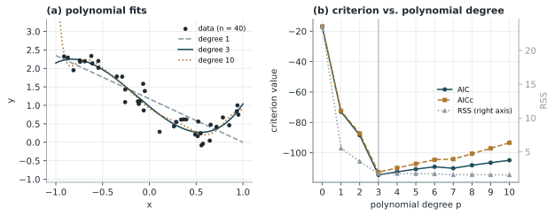

# Akaike 資訊準則（AIC）

!!! info "本頁的 AIC"
    本頁介紹統計學中用於模型選擇的 Akaike 資訊準則。若要了解訊號起始點偵測所用的 AIC picker，請見 [AIC picker：起始點偵測](../signal-detection/aic-picker.md)；兩者的關係也在該頁說明。

!!! abstract "摘要"
    Akaike 資訊準則（Akaike Information Criterion, AIC）由 Akaike 於 1974 年提出，用於在多個候選模型中選出最適合的一個。它以最大概似估計的對數概似值衡量模型對資料的配適程度，並以模型參數數量作為懲罰項，在「配適不足」與「過度配適」之間取得平衡。AIC 在理論上是模型與真實資料分布之間 Kullback–Leibler 散度的估計量。AIC 數值本身沒有絕對意義，只能在同一組資料、不同模型之間比較。本講義說明 AIC 的定義、推導概念、最小平方情形下的形式、小樣本修正與使用限制。

    **前置講義**：無（需具備最大概似估計的基本概念）

## 1. 背景與動機

建立模型時，增加參數幾乎總能讓模型更貼近訓練資料。以多項式迴歸為例，次數越高，殘差平方和（residual sum of squares, RSS）只會下降或持平，最後甚至能穿過每一個資料點。然而這樣的模型同時擬合了雜訊，面對新資料時表現反而變差，這就是過度配適（overfitting）。

因此，只看配適誤差無法決定模型的複雜度，需要一個同時考量「配適程度」與「模型複雜度」的準則。AIC 提供了這樣的準則，而且有明確的資訊理論基礎：它估計的是模型用於預測新資料時，與真實資料生成機制之間的資訊損失。

## 2. 數學定義與推導

### 2.1 定義

設模型有 \(k\) 個需估計的參數，\(\hat{L}\) 為其概似函數的最大值，則

$$
\mathrm{AIC} = -2\ln\hat{L} + 2k
\tag{1}
$$

第一項衡量配適程度（配適越好，\(\ln\hat{L}\) 越大，此項越小），第二項為複雜度懲罰。比較候選模型時，選擇 AIC 最小者。

### 2.2 推導概念

設真實資料分布為 \(f\)，候選模型為 \(g_\theta\)。兩者之間的資訊損失可用 Kullback–Leibler 散度衡量：

$$
D_{\mathrm{KL}}(f \,\|\, g_\theta) = \int f(y)\ln\frac{f(y)}{g_\theta(y)}\,dy
= \underbrace{\int f\ln f\,dy}_{\text{與模型無關}} - \mathbb{E}_f\!\left[\ln g_\theta(Y)\right]
\tag{2}
$$

比較模型時只需比較第二項，也就是期望對數概似。直覺上可以用樣本的最大對數概似 \(\ln\hat{L}\) 來估計它，但參數是用同一組資料估計出來的，因此 \(\ln\hat{L}\) 過於樂觀。Akaike 證明在大樣本與適當條件下，這個偏差約等於參數數量 \(k\)。修正偏差並乘上 \(-2\) 後，即得式 (1)。

### 2.3 最小平方情形

若模型誤差為獨立、同分布的常態分布，以最小平方法配適 \(n\) 筆資料，變異數的最大概似估計為 \(\hat{\sigma}^2 = \mathrm{RSS}/n\)，此時

$$
\ln\hat{L} = -\frac{n}{2}\left[\ln(2\pi) + \ln\hat{\sigma}^2 + 1\right]
\tag{3}
$$

代入式 (1) 並去除與模型無關的常數，得到實務上常用的形式：

$$
\mathrm{AIC} = n\ln\!\left(\frac{\mathrm{RSS}}{n}\right) + 2k
\tag{4}
$$

!!! note "參數數量 k 的計算"
    \(k\) 應包含所有被估計的參數，包括雜訊變異數 \(\sigma^2\)。若所有候選模型都估計 \(\sigma^2\)，是否把它計入只會讓所有 AIC 平移相同的常數，不影響排序；但同一份分析中的計算方式必須一致。

### 2.4 小樣本修正（AICc）

當樣本數 \(n\) 相對參數數量 \(k\) 不夠大時，式 (1) 的懲罰不足，容易選到過大的模型。Hurvich 與 Tsai 提出修正版：

$$
\mathrm{AICc} = \mathrm{AIC} + \frac{2k(k+1)}{n-k-1}
\tag{5}
$$

Burnham 與 Anderson 建議在 \(n/k\) 小於約 40 時使用 AICc。當 \(n\) 很大時，修正項趨近於零，AICc 與 AIC 一致。

### 2.5 AIC 差值與 Akaike 權重

AIC 的絕對大小沒有意義，應看模型之間的差值。令 \(\mathrm{AIC}_{\min}\) 為所有候選模型中的最小值：

$$
\Delta_i = \mathrm{AIC}_i - \mathrm{AIC}_{\min}
\tag{6}
$$

$$
w_i = \frac{\exp(-\Delta_i/2)}{\sum_{r}\exp(-\Delta_r/2)}
\tag{7}
$$

\(w_i\) 稱為 Akaike 權重，可解讀為在候選集合中，模型 \(i\) 為最佳模型的相對證據強度。Burnham 與 Anderson 提出的經驗判斷為：\(\Delta_i \le 2\) 表示該模型仍有相當支持；\(\Delta_i\) 介於 4 至 7 時支持明顯較弱；\(\Delta_i > 10\) 時幾乎沒有支持。

### 2.6 與 BIC 的比較

另一個常見準則是貝氏資訊準則（Bayesian Information Criterion, BIC）：

$$
\mathrm{BIC} = -2\ln\hat{L} + k\ln n
\tag{8}
$$

當 \(n \ge 8\) 時 \(\ln n > 2\)，BIC 對參數的懲罰比 AIC 重，傾向選擇較精簡的模型。兩者目標不同：AIC 著重預測表現，BIC 著重在樣本數增加時選中真實模型（若真實模型在候選集合中）。

## 3. 圖解與範例

以 \(n = 40\) 筆合成資料示範多項式次數的選擇。資料由三次多項式 \(y = 1 - 2x + 0.5x^2 + 1.5x^3\) 加上標準差 0.3 的常態雜訊產生，再以 0 至 10 次多項式分別配適，參數數量取 \(k = p + 2\)（\(p+1\) 個係數加上雜訊變異數）。

<figure markdown="span">
  { width="720" }
  <figcaption>圖 1　(a) 1 次、3 次與 10 次多項式的配適結果；(b) AIC、AICc 與 RSS 隨多項式次數的變化。RSS 持續下降，AIC 與 AICc 皆在 3 次時達到最小值。</figcaption>
</figure>

圖 1(b) 顯示，RSS 在 3 次之後幾乎不再下降，但參數持續增加，因此 AIC 從 3 次開始回升，正確選出產生資料的次數。AICc 的懲罰更重，在高次數時上升得更快。圖 1(a) 中的 10 次多項式雖然 RSS 最小，但在資料範圍邊緣出現劇烈擺動，是典型的過度配適。

## 4. Python 實作

以下只使用 NumPy，以式 (4) 與式 (5) 比較不同次數的多項式。

```python
import numpy as np

rng = np.random.default_rng(42)
n = 40
x = np.sort(rng.uniform(-1, 1, n))
y = 1 - 2 * x + 0.5 * x**2 + 1.5 * x**3 + 0.3 * rng.standard_normal(n)


def aic_least_squares(rss, n, k):
    """最小平方情形下的 AIC 與 AICc，見式 (4)、(5)。"""
    aic = n * np.log(rss / n) + 2 * k
    aicc = aic + 2 * k * (k + 1) / (n - k - 1)
    return aic, aicc


results = []
for p in range(0, 11):
    coef = np.polyfit(x, y, p)
    rss = np.sum((y - np.polyval(coef, x)) ** 2)
    k = p + 2                                   # p+1 個係數 + 雜訊變異數
    aic, aicc = aic_least_squares(rss, n, k)
    results.append((p, rss, aic, aicc))
    print(f"p = {p:2d}  RSS = {rss:7.3f}  AIC = {aic:8.2f}  AICc = {aicc:8.2f}")

best = min(results, key=lambda r: r[2])
print("AIC 選出的次數：", best[0])
```

## 5. 應用實例

**自迴歸模型的階數選擇。** AIC 最早的重要應用之一是選擇時間序列自迴歸（autoregressive, AR）模型的階數。在訊號處理中，AR 模型常用於頻譜估計與訊號建模，階數過低無法描述頻譜特徵，過高則產生虛假的峰值。

**特徵與變數選擇。** 在迴歸分析中比較不同變數組合，或決定特徵數量時，AIC 可作為客觀的比較依據。

**訊號分段。** 若把訊號在某一點切開，前後兩段各自視為一個模型，就能用 AIC 判斷切在哪裡最合理。這正是 [AIC picker](../signal-detection/aic-picker.md) 的原理。

## 6. 限制與注意事項

- **只能相對比較。** AIC 只告訴我們候選模型中哪一個相對較好；若所有候選模型都不適當，AIC 仍會選出其中一個。模型診斷（殘差分析等）仍不可省略。
- **必須使用相同資料。** 不同模型的 AIC 必須以完全相同的觀測資料計算。例如對 \(y\) 取對數後配適的模型，不能直接與原始 \(y\) 的模型比較 AIC。
- **大樣本近似。** 推導依賴大樣本假設，小樣本時應改用 AICc。
- **不是假設檢定。** AIC 差值不是 p 值，不應以「顯著」描述 AIC 的比較結果。
- **傾向較大的模型。** 相較於 BIC，AIC 在樣本很大時仍可能選擇比真實模型稍大的模型；若分析目的是找出真實結構而非預測，可同時參考 BIC。

## 7. 相關講義

- [AIC picker：起始點偵測](../signal-detection/aic-picker.md)：AIC 在訊號分段上的應用。

## 參考文獻

<div class="references" markdown>

1. H. Akaike, "A new look at the statistical model identification," *IEEE Transactions on Automatic Control*, vol. 19, no. 6, pp. 716–723, 1974.
2. K. P. Burnham and D. R. Anderson, *Model Selection and Multimodel Inference: A Practical Information-Theoretic Approach*, 2nd ed. New York, NY, USA: Springer, 2002.
3. C. M. Hurvich and C.-L. Tsai, "Regression and time series model selection in small samples," *Biometrika*, vol. 76, no. 2, pp. 297–307, 1989.
4. G. Schwarz, "Estimating the dimension of a model," *The Annals of Statistics*, vol. 6, no. 2, pp. 461–464, 1978.

</div>
