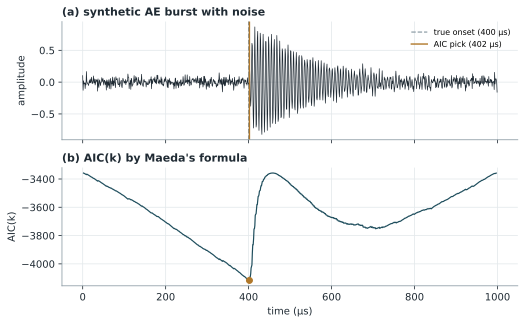

# AIC picker：起始點偵測

!!! info "本頁的 AIC"
    AIC picker 的名稱來自統計學的 Akaike 資訊準則。建議先閱讀 [Akaike 資訊準則（AIC）](../model-selection/aic.md)，再閱讀本頁 2.3 節的推導，會更容易理解兩者的關係。

!!! abstract "摘要"
    AIC picker 是一種自動判讀暫態訊號起始時間（onset time，亦稱到達時間 arrival time）的方法，廣泛用於聲發射、地震波與超音波訊號。其想法是把訊號在候選點 \(k\) 處切成前後兩段，假設前段只有雜訊、後段包含訊號，兩段各自以平穩的隨機過程描述；計算整體的 AIC 後，AIC 最小的切點即為起始點的估計。Maeda 於 1985 年提出直接由兩段波形的變異數計算 AIC 的簡化公式，不需先估計自迴歸模型係數，因此計算簡單、應用普遍。本講義說明此方法的公式、與 Akaike 資訊準則的關係、實作方式與使用限制。

    **前置講義**：[Akaike 資訊準則（AIC）](../model-selection/aic.md)

## 1. 背景與動機

在聲發射檢測中，同一個破裂事件產生的彈性波會在不同時間抵達多個感測器。這些到達時間的差異是定位破裂來源的基礎，因此起始時間判讀得越準確，定位結果就越可靠。

最直觀的方法是門檻法：訊號振幅第一次超過設定門檻的時間即視為起始點。然而門檻法的結果取決於門檻高低與訊號振幅；當訊號緩慢上升或訊噪比偏低時，超過門檻的時間會明顯晚於真正的起始點。人工判讀雖然準確，卻耗時且帶有主觀性，無法處理大量資料。

AIC picker 不依賴門檻，而是尋找訊號統計特性發生改變的位置：起始點之前是雜訊，之後是訊號，兩者的變異數截然不同。這讓它在低訊噪比的情況下也能得到穩定的結果。

## 2. 數學定義與推導

### 2.1 Maeda 公式

設訊號 \(x[1], x[2], \dots, x[N]\) 共 \(N\) 個樣本，對每個候選切點 \(k\) 計算

$$
\mathrm{AIC}(k) = k\,\log\!\big(\operatorname{var}(x[1,k])\big) + (N-k-1)\,\log\!\big(\operatorname{var}(x[k+1,N])\big)
\tag{1}
$$

其中 \(x[1,k]\) 表示第 1 至第 \(k\) 個樣本，\(\operatorname{var}(\cdot)\) 為該段樣本的變異數。起始點估計為

$$
\hat{k} = \arg\min_{k}\ \mathrm{AIC}(k)
\tag{2}
$$

對數的底數不影響 \(\hat{k}\)，以自然對數或常用對數計算皆可。若取樣頻率為 \(f_s\)、視窗起點時間為 \(t_0\)，則起始時間為 \(t_0 + \hat{k}/f_s\)（以 0 為起點的陣列索引計算時，\(\hat{k}\) 即為訊號段第一個樣本的索引）。

### 2.2 直覺說明

- 當 \(k\) 位於真正起始點之前，後段同時包含雜訊與訊號，但前段只有雜訊，變異數很小，\(\log\) 值為很大的負數，且隨 \(k\) 增加而累積，使 AIC 逐漸下降。
- 當 \(k\) 越過起始點，前段開始混入訊號，前段變異數急遽上升，AIC 隨之快速增加。

因此 AIC 曲線在起始點附近形成明顯的全域最小值，如圖 1(b) 所示。

### 2.3 與 Akaike 資訊準則的關係

將前後兩段分別視為平均值與變異數各自固定的常態過程。長度為 \(m\)、變異數最大概似估計為 \(\hat{\sigma}^2\) 的一段資料，其 \(-2\ln\hat{L}\) 為 \(m\ln\hat{\sigma}^2\) 加上只與 \(m\) 成正比的常數。兩段合計：

$$
-2\ln\hat{L}(k) = k\ln\hat{\sigma}_1^2 + (N-k)\ln\hat{\sigma}_2^2 + N\big(\ln 2\pi + 1\big)
\tag{3}
$$

最後一項與 \(k\) 無關；而不論切在哪裡，模型的參數數量都相同，因此 AIC 的懲罰項 \(2k_{\text{param}}\) 也是常數。於是「在所有切點中找 AIC 最小值」等價於找出讓兩段模型概似最大的切點，式 (3) 去除常數後即與式 (1) 相同（Maeda 公式中的 \(N-k-1\) 與此處的 \(N-k\) 只差一個樣本的計數，對結果影響極小）。

換言之，AIC picker 是把 [AIC](../model-selection/aic.md) 用來比較「切在不同位置」的一系列兩段模型。

## 3. 圖解與範例

圖 1 以合成聲發射訊號示範。訊號長度 1000 點，取樣頻率 1 MHz，前 400 µs 為標準差 0.05 的常態雜訊，之後疊加一個 150 kHz、快速上升後指數衰減的暫態波形。

<figure markdown="span">
  { width="660" }
  <figcaption>圖 1　(a) 合成聲發射訊號，虛線為真實起始點，實線為 AIC picker 的判讀結果；(b) 依式 (1) 計算的 AIC 曲線，最小值位置即為起始點估計。</figcaption>
</figure>

在此例中，真實起始點為 400 µs，AIC picker 判讀為 402 µs，誤差為 2 個樣本。由於暫態波形是逐漸上升而非瞬間跳起，起始後最初幾個樣本的振幅仍與雜訊相當，這是產生少量延遲的原因。

## 4. Python 實作

以下函式直接依式 (1) 計算，只需 NumPy。兩段都至少保留 2 個樣本，以避免變異數為 0 導致對數無定義。

```python
import numpy as np


def aic_picker(x):
    """以 Maeda (1985) 公式計算 AIC 曲線，回傳 (起始點索引, AIC 陣列)。"""
    x = np.asarray(x, dtype=float)
    n = len(x)
    aic = np.full(n, np.nan)
    for k in range(2, n - 2):
        v1 = np.var(x[:k])          # 前段：x[0] ~ x[k-1]
        v2 = np.var(x[k:])          # 後段：x[k] ~ x[n-1]
        if v1 > 0 and v2 > 0:
            aic[k] = k * np.log(v1) + (n - k - 1) * np.log(v2)
    return int(np.nanargmin(aic)), aic


# 合成訊號：前 400 點為雜訊，之後加入衰減的暫態波形
rng = np.random.default_rng(3)
fs = 1_000_000
n, onset = 1000, 400
x = 0.05 * rng.standard_normal(n)
tau = np.arange(n - onset)
x[onset:] += np.exp(-tau / 150) * (1 - np.exp(-tau / 8)) * np.sin(2 * np.pi * 150e3 * tau / fs)

k_hat, aic = aic_picker(x)
print(f"判讀起始點：第 {k_hat} 點，即 {k_hat / fs * 1e6:.0f} µs")
```

!!! tip "長訊號的加速寫法"
    上面的迴圈每次都重新計算變異數，時間複雜度為 \(O(N^2)\)。利用累積和可以一次算出所有切點的變異數，複雜度降為 \(O(N)\)：

    ```python
    def aic_picker_fast(x):
        x = np.asarray(x, dtype=float)
        n = len(x)
        k = np.arange(2, n - 2)
        c1, c2 = np.cumsum(x), np.cumsum(x ** 2)
        v1 = c2[k - 1] / k - (c1[k - 1] / k) ** 2
        v2 = (c2[-1] - c2[k - 1]) / (n - k) - ((c1[-1] - c1[k - 1]) / (n - k)) ** 2
        aic = np.full(n, np.nan)
        valid = (v1 > 0) & (v2 > 0)
        aic[k[valid]] = k[valid] * np.log(v1[valid]) + (n - k[valid] - 1) * np.log(v2[valid])
        return int(np.nanargmin(aic)), aic
    ```

## 5. 應用實例

**聲發射源定位。** 在混凝土、複合材料與金屬結構的聲發射檢測中，AIC picker 常用於判讀各感測器的到達時間，再以到達時間差計算破裂位置。Kurz 等人比較了多種自動判讀策略，並討論如何結合不同方法以提高可靠度。

**地震波判讀。** AIC 類方法源自地震學中 P 波到達時間的自動判讀，至今仍是地震資料自動處理的常用工具之一。

**加工訊號的事件切割。** 在砂輪磨削等加工監測中，可先以 AIC picker 找出每個聲發射事件的起點，切出事件波形後，再以 [DWT](../signal-processing/dwt.md) 或 [WPD](../signal-processing/wpd.md) 擷取頻帶特徵。

## 6. 限制與注意事項

!!! warning "一個視窗只能有一個起始點"
    式 (2) 只回傳全域最小值。若視窗內有多個暫態事件，或只有雜訊而沒有事件，結果都沒有意義。實務上常先以門檻法或短期／長期平均比（STA/LTA）找出事件的大略位置，再在其周圍取一個只含單一起始點的視窗計算 AIC。

- **邊界不穩定。** 切點靠近視窗兩端時，其中一段只有少數樣本，變異數估計不可靠，AIC 值可能出現極端值。實作時應排除兩端若干樣本。
- **低訊噪比。** 訊號緩慢上升或振幅接近雜訊時，判讀點會往後偏移；必要時可先帶通濾波或以小波去雜訊。
- **前處理會影響結果。** 濾波會改變波形的上升特性，也可能引入相位延遲。比較不同感測器的到達時間時，所有通道必須使用相同的前處理。
- **統計改變點不等於物理到達點。** AIC picker 找的是變異數改變的位置；在波傳播有頻散或多種波模態的情況下，它對應的物理意義需要另行判斷。

## 7. 相關講義

- [Akaike 資訊準則（AIC）](../model-selection/aic.md)：本方法的理論基礎。
- [離散小波轉換（DWT）](../signal-processing/dwt.md)：可用於去雜訊前處理。
- [小波封包分解（WPD）](../signal-processing/wpd.md)：可用於切出事件後的特徵擷取。

## 參考文獻

<div class="references" markdown>

1. N. Maeda, "A method for reading and checking phase times in autoprocessing system of seismic wave data," *Zisin (Journal of the Seismological Society of Japan, 2nd ser.)*, vol. 38, no. 3, pp. 365–379, 1985.
2. R. Sleeman and T. van Eck, "Robust automatic P-phase picking: An on-line implementation in the analysis of broadband seismogram recordings," *Physics of the Earth and Planetary Interiors*, vol. 113, no. 1–4, pp. 265–275, 1999.
3. J. H. Kurz, C. U. Grosse, and H.-W. Reinhardt, "Strategies for reliable automatic onset time picking of acoustic emissions and of ultrasound signals in concrete," *Ultrasonics*, vol. 43, no. 7, pp. 538–546, 2005.
4. H. Akaike, "A new look at the statistical model identification," *IEEE Transactions on Automatic Control*, vol. 19, no. 6, pp. 716–723, 1974.

</div>
