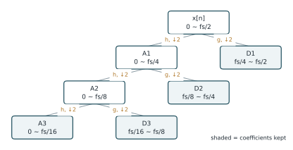
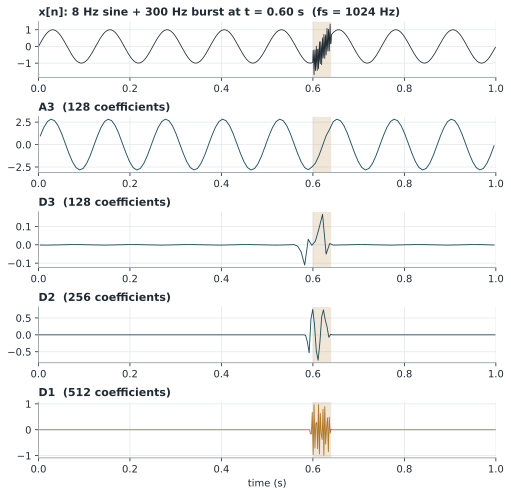

# 離散小波轉換（DWT）

!!! abstract "摘要"
    離散小波轉換（Discrete Wavelet Transform, DWT）以一組可伸縮、可平移的小波函數分析訊號，能同時保留時間與頻率的局部資訊。實作上採用 Mallat 演算法，以低通與高通濾波器搭配二倍降取樣，將訊號逐層分解為近似係數與細節係數，形成以二進位方式劃分的頻帶。本講義說明 DWT 的動機、多解析度分析的數學架構、濾波器組的計算方式，以及頻帶劃分的意義與限制。

    **前置講義**：無（需具備傅立葉轉換的基本概念）

## 1. 背景與動機

傅立葉轉換（Fourier transform）將訊號表示為不同頻率正弦波的疊加，能清楚呈現訊號的頻率組成，但基底函數在時間上無限延伸，因此無法指出某個頻率成分「何時」出現。對於聲發射（acoustic emission, AE）、機械衝擊或故障訊號這類短暫、非平穩的暫態訊號，時間位置往往與頻率內容同樣重要。

短時傅立葉轉換（short-time Fourier transform, STFT）以固定長度的視窗切段分析，取得時頻資訊，但視窗長度一旦固定，所有頻率都只能使用相同的時間與頻率解析度。依據不確定性原理，兩者無法同時任意提高：短視窗利於定位暫態，卻犧牲頻率解析度；長視窗則相反。

小波轉換的核心想法是讓解析度隨頻率改變：分析高頻成分時使用時間上較短的小波，以精確定位暫態；分析低頻成分時使用較長的小波，以分辨相近的頻率。DWT 是此想法在離散訊號上最常用、計算效率最高的實作形式。

## 2. 數學定義與推導

### 2.1 小波函數與連續小波轉換

給定一個母小波（mother wavelet）\(\psi(t)\)，以尺度參數 \(a > 0\) 與平移參數 \(b\) 產生一族小波函數：

$$
\psi_{a,b}(t) = \frac{1}{\sqrt{a}}\,\psi\!\left(\frac{t-b}{a}\right)
\tag{1}
$$

訊號 \(x(t)\) 的連續小波轉換（continuous wavelet transform, CWT）定義為訊號與各小波函數的內積：

$$
W_x(a,b) = \int_{-\infty}^{\infty} x(t)\,\psi_{a,b}^{*}(t)\,dt
\tag{2}
$$

其中 \(^{*}\) 表示共軛複數。尺度 \(a\) 越大，小波越寬，對應越低的頻率。

### 2.2 二進位離散化

DWT 只取二進位（dyadic）的尺度與平移，令 \(a = 2^{j}\)、\(b = k\,2^{j}\)，其中 \(j, k\) 為整數：

$$
\psi_{j,k}(t) = 2^{-j/2}\,\psi\!\left(2^{-j}t - k\right)
\tag{3}
$$

在適當選擇的母小波下（例如 Daubechies 小波），\(\{\psi_{j,k}\}\) 構成正交基底，訊號可以無冗餘地展開。

### 2.3 多解析度分析

多解析度分析（multiresolution analysis, MRA）再引入一個尺度函數（scaling function）\(\varphi(t)\)，負責表示訊號的粗略輪廓。分解到第 \(J\) 層時，訊號可寫為

$$
x(t) = \sum_{k} a_J[k]\,\varphi_{J,k}(t) + \sum_{j=1}^{J}\sum_{k} d_j[k]\,\psi_{j,k}(t)
\tag{4}
$$

其中 \(a_J[k]\) 稱為近似係數（approximation coefficients），\(d_j[k]\) 稱為第 \(j\) 層的細節係數（detail coefficients）。

### 2.4 Mallat 演算法（濾波器組實作）

Mallat 證明式 (4) 的係數不必透過積分計算，只需一組低通濾波器 \(h[n]\) 與高通濾波器 \(g[n]\) 重複作用，並各自進行二倍降取樣。令 \(a_0[n] = x[n]\)，第 \(j\) 層的係數為

$$
a_{j}[n] = \sum_{k} h[k-2n]\,a_{j-1}[k]
\tag{5}
$$

$$
d_{j}[n] = \sum_{k} g[k-2n]\,a_{j-1}[k]
\tag{6}
$$

對正交小波而言，高通濾波器由低通濾波器決定（正交鏡像關係，\(L\) 為濾波器長度，正負號慣例依文獻而異）：

$$
g[k] = (-1)^{k}\,h[L-1-k]
\tag{7}
$$

每經過一層，近似係數與細節係數的數量約減半，下一層只對近似係數 \(a_j\) 繼續分解。

### 2.5 頻帶劃分

設取樣頻率為 \(f_s\)，則原始訊號的頻率範圍為 \(0\) 至 \(f_s/2\)。在理想濾波器的假設下，第 \(j\) 層細節係數與第 \(J\) 層近似係數對應的頻帶為

$$
d_j:\ \left[\frac{f_s}{2^{j+1}},\ \frac{f_s}{2^{j}}\right],
\qquad
a_J:\ \left[0,\ \frac{f_s}{2^{J+1}}\right]
\tag{8}
$$

此外，對正交小波並採用週期延伸時，轉換保持能量（Parseval 關係）：

$$
\sum_{n}|x[n]|^2 = \sum_{k}|a_J[k]|^2 + \sum_{j=1}^{J}\sum_{k}|d_j[k]|^2
\tag{9}
$$

因此各層係數的能量可以直接解讀為訊號能量在各頻帶上的分配。

## 3. 圖解與範例

圖 1 為三層 DWT 的分解樹。每一層只對近似係數（低頻部分）繼續分解，最終保留的係數為 \(A_3, D_3, D_2, D_1\)。

<figure markdown="span">
  { width="640" }
  <figcaption>圖 1　三層離散小波轉換的分解樹。h、g 分別為低通與高通濾波器，↓2 表示二倍降取樣；框內為各節點對應的理想頻帶，淺藍底色的框為最終保留的係數。</figcaption>
</figure>

以取樣頻率 \(f_s = 1\) MHz 的聲發射訊號為例，依式 (8) 計算三層分解後的頻帶如下表。

| 係數 | 頻帶 | 係數數量（原始長度 \(N\)） |
| --- | --- | --- |
| \(D_1\) | 250 ~ 500 kHz | 約 \(N/2\) |
| \(D_2\) | 125 ~ 250 kHz | 約 \(N/4\) |
| \(D_3\) | 62.5 ~ 125 kHz | 約 \(N/8\) |
| \(A_3\) | 0 ~ 62.5 kHz | 約 \(N/8\) |

圖 2 以合成訊號示範 DWT 的時間定位能力。訊號由 8 Hz 正弦波與 0.60 秒處持續 40 毫秒的 300 Hz 短暫成分組成（\(f_s = 1024\) Hz）。8 Hz 成分完整保留在 \(A_3\)（0 ~ 64 Hz）；300 Hz 成分落在 \(D_1\)（256 ~ 512 Hz），且只在 0.60 秒附近出現非零係數，清楚標示暫態的時間位置。\(D_2\)、\(D_3\) 在相同時間也有反應，原因是短暫成分的突然開始與結束本身含有寬頻成分。

<figure markdown="span">
  { width="640" }
  <figcaption>圖 2　合成訊號（上）及其三層 DWT 係數。淺色區間為 300 Hz 短暫成分所在的時間；係數已依其對應時間對齊原始訊號。小波為 Daubechies 4（db4）。</figcaption>
</figure>

## 4. Python 實作

以下使用 PyWavelets 套件（`pip install PyWavelets`）完成三層分解、各層能量計算與重建。`pywt.wavedec` 回傳的串列順序為 \([A_J, D_J, \dots, D_1]\)。

```python
import numpy as np
import pywt

fs = 1000                                   # 取樣頻率 (Hz)
t = np.arange(0, 1, 1 / fs)
x = np.sin(2 * np.pi * 10 * t)              # 低頻成分
x[600:640] += np.sin(2 * np.pi * 300 * t[600:640])   # 短暫的高頻成分

coeffs = pywt.wavedec(x, wavelet="db4", level=3)     # [A3, D3, D2, D1]

for name, c in zip(["A3", "D3", "D2", "D1"], coeffs):
    print(f"{name}: {len(c):4d} 個係數，能量 = {np.sum(c ** 2):8.3f}")

x_rec = pywt.waverec(coeffs, wavelet="db4")[: len(x)]
print("最大重建誤差：", np.max(np.abs(x - x_rec)))
```

可分解的最大層數受訊號長度與濾波器長度限制，可用 `pywt.dwt_max_level(len(x), "db4")` 查詢。

## 5. 應用實例

**暫態訊號的特徵擷取。** 在砂輪磨削、刀具切削等加工監測中，聲發射訊號由材料破裂、磨粒脫落等事件產生，屬於短暫的高頻暫態。DWT 能把訊號拆成數個頻帶，常見做法是計算各層係數的能量、均方根值或統計量，作為描述加工狀態的特徵。

**去雜訊。** 雜訊通常均勻散布在各細節係數中，而有意義的暫態集中於少數大係數。Donoho 與 Johnstone 提出對細節係數做閾值處理後再重建，常用的通用閾值為

$$
\lambda = \hat{\sigma}\sqrt{2\ln N}, \qquad \hat{\sigma} = \frac{\operatorname{median}(|d_1[k]|)}{0.6745}
\tag{10}
$$

其中 \(\hat{\sigma}\) 是以第一層細節係數估計的雜訊標準差。去雜訊後的訊號也常作為起始點偵測（見 [AIC picker](../signal-detection/aic-picker.md)）的前處理。

## 6. 限制與注意事項

!!! warning "高頻區域的頻率解析度不足"
    DWT 只對近似係數繼續分解，因此高頻頻帶始終很寬（例如 \(D_1\) 涵蓋整個上半頻帶）。若關心的資訊位於中高頻，需改用[小波封包分解](wpd.md)。

- **頻帶並非理想切割。** 實際濾波器有過渡帶，相鄰頻帶會互相滲漏，接近頻帶邊界的頻率成分會同時出現在兩個係數中。濾波器越長（例如 db8 比 db4 長），分頻效果越好，但時間定位較差。
- **平移敏感。** 因為降取樣，訊號平移一個樣本可能使係數明顯改變。若需要平移不變性，可改用靜態小波轉換（stationary wavelet transform, SWT）。
- **邊界效應。** 訊號兩端需要延伸（對稱、週期或補零），不同延伸方式會影響邊界附近的係數，分析時應避開或另行處理。
- **參數選擇。** 母小波種類與分解層數會影響結果，應依訊號特性選擇，並在報告中明確寫出所用設定。

## 7. 相關講義

- [小波封包分解（WPD）](wpd.md)：延伸 DWT，對細節係數也繼續分解。
- [AIC picker：起始點偵測](../signal-detection/aic-picker.md)：DWT 去雜訊可作為其前處理。

## 參考文獻

<div class="references" markdown>

1. S. G. Mallat, "A theory for multiresolution signal decomposition: The wavelet representation," *IEEE Transactions on Pattern Analysis and Machine Intelligence*, vol. 11, no. 7, pp. 674–693, 1989.
2. I. Daubechies, *Ten Lectures on Wavelets*. Philadelphia, PA, USA: SIAM, 1992.
3. D. L. Donoho and I. M. Johnstone, "Ideal spatial adaptation by wavelet shrinkage," *Biometrika*, vol. 81, no. 3, pp. 425–455, 1994.
4. G. R. Lee, R. Gommers, F. Wasilewski, K. Wohlfahrt, and A. O'Leary, "PyWavelets: A Python package for wavelet analysis," *Journal of Open Source Software*, vol. 4, no. 36, p. 1237, 2019.

</div>
