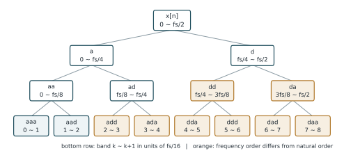
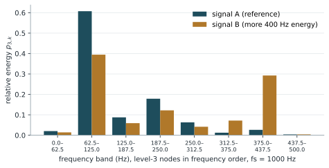

# 小波封包分解（WPD）

!!! abstract "摘要"
    小波封包分解（Wavelet Packet Decomposition, WPD）是離散小波轉換的推廣：每一層不只分解近似係數，也繼續分解細節係數，形成完整的二元樹。分解到第 \(j\) 層時共有 \(2^{j}\) 個節點，每個節點對應寬度為 \(f_s/2^{j+1}\) 的頻帶，使高頻區域也能獲得細緻的頻率解析度。各節點的能量或相對能量常被組成特徵向量，用於狀態監測與分類。本講義說明 WPD 的定義、節點的頻率排序問題、能量特徵的計算方式，以及使用時的注意事項。

    **前置講義**：[離散小波轉換（DWT）](dwt.md)

## 1. 背景與動機

在 [DWT](dwt.md) 中，只有低頻部分會被反覆細分，高頻部分始終保持很寬的頻帶。以 \(f_s = 1\) MHz 為例，第一層細節係數 \(D_1\) 就涵蓋 250 ~ 500 kHz 整個區間，無法區分 300 kHz 與 450 kHz 的成分。

然而，許多工程訊號的關鍵資訊恰好位於中高頻。聲發射訊號的頻率內容常延伸至數百 kHz，機台狀態改變時，能量可能在數個高頻頻帶之間移動。WPD 對每個節點都繼續分解，使所有頻率區域的解析度一致，因而更適合觀察能量在整個頻譜上的分布。

## 2. 數學定義與推導

### 2.1 節點遞迴

以 \((j, n)\) 表示第 \(j\) 層的第 \(n\) 個節點（\(n = 0, 1, \dots, 2^{j}-1\)），其係數記為 \(w_{j,n}[m]\)。令根節點 \(w_{0,0}[m] = x[m]\)，每個節點都以 DWT 所用的低通濾波器 \(h\) 與高通濾波器 \(g\) 分解成兩個子節點：

$$
w_{j+1,\,2n}[m] = \sum_{k} h[k-2m]\, w_{j,n}[k]
\tag{1}
$$

$$
w_{j+1,\,2n+1}[m] = \sum_{k} g[k-2m]\, w_{j,n}[k]
\tag{2}
$$

此處的索引 \(n\) 稱為自然順序（natural order，亦稱 Paley order）。若以 a 代表經過低通、d 代表經過高通，節點也可以用路徑字串表示，例如 `ad` 表示先低通再高通。

### 2.2 頻帶寬度

第 \(j\) 層的 \(2^{j}\) 個節點均分 \(0\) 至 \(f_s/2\) 的頻率範圍，每個節點的頻寬為

$$
\Delta f_j = \frac{f_s}{2^{j+1}}
\tag{3}
$$

### 2.3 自然順序與頻率順序

自然順序並不等於頻率由低到高的順序。高通濾波後再降取樣，會使該分支的頻譜左右翻轉；翻轉過的節點再分解時，「低通」子節點反而對應較高的頻率。設 \(k\) 為頻率順序（\(k = 0\) 為最低頻），對應的自然順序索引為 \(k\) 的格雷碼（Gray code）：

$$
n = k \oplus \left\lfloor k/2 \right\rfloor
\tag{4}
$$

其中 \(\oplus\) 為位元互斥或（XOR）。第 3 層的對應關係如下表。

| 頻率順序 \(k\) | 0 | 1 | 2 | 3 | 4 | 5 | 6 | 7 |
| --- | --- | --- | --- | --- | --- | --- | --- | --- |
| 自然順序 \(n\) | 0 | 1 | 3 | 2 | 6 | 7 | 5 | 4 |
| 路徑 | aaa | aad | add | ada | dda | ddd | dad | daa |

!!! warning "注意"
    直接依自然順序畫出能量分布圖，會把頻帶的位置排錯。使用 PyWavelets 時應指定 `get_level(level, order="freq")`。

### 2.4 能量特徵

第 \(j\) 層第 \(k\) 個頻帶（依頻率順序）的能量與相對能量定義為

$$
E_{j,k} = \sum_{m} \left| w_{j,k}[m] \right|^2
\tag{5}
$$

$$
p_{j,k} = \frac{E_{j,k}}{\sum_{i=0}^{2^{j}-1} E_{j,i}}
\tag{6}
$$

將同一層的相對能量依頻率順序排列，即得到能量分布特徵向量

$$
\mathbf{p}_j = \left[\,p_{j,0},\ p_{j,1},\ \dots,\ p_{j,2^{j}-1}\,\right]^{\mathsf T}
\tag{7}
$$

由於 \(\sum_k p_{j,k} = 1\)，此向量描述的是能量的「分布形狀」，不受訊號整體振幅或放大器增益影響。

### 2.5 最佳基底選擇

完整的封包樹包含許多可能的頻帶組合。Coifman 與 Wickerhauser 提出以代價函數（例如 Shannon 熵）由下而上比較：若父節點的代價小於或等於兩個子節點代價之和，就保留父節點，否則保留子節點。如此可得到最精簡表示訊號的一組節點，稱為最佳基底（best basis）。

## 3. 圖解與範例

圖 1 為三層完整封包樹。每一層的節點已依頻率由低到高排列，框內為路徑字串；橘色框表示其頻率順序與自然順序不同。

<figure markdown="span">
  { width="700" }
  <figcaption>圖 1　三層小波封包分解樹，各層節點依頻率由低到高排列。框內上方為路徑字串（a 為低通、d 為高通），下方為對應頻帶；最下層以 fs/16 為單位。</figcaption>
</figure>

以 \(f_s = 1\) MHz 為例，第 3 層的 8 個節點各涵蓋 62.5 kHz：從 0 ~ 62.5 kHz 一直到 437.5 ~ 500 kHz，高頻區與低頻區的解析度相同。

圖 2 比較兩組合成訊號的第 3 層相對能量（\(f_s = 1000\) Hz，每個頻帶 62.5 Hz）。兩者都含 90 Hz 與 210 Hz 成分，訊號 B 另含較強的 400 Hz 成分。可以看到 B 在 375 ~ 437.5 Hz 頻帶的相對能量明顯上升，其他頻帶的比例則相應下降。此外，0 ~ 62.5 Hz 等不含正弦成分的頻帶仍有少量能量，來自隨機雜訊與濾波器的頻帶滲漏。

<figure markdown="span">
  { width="640" }
  <figcaption>圖 2　兩組合成訊號在第 3 層各頻帶的相對能量（db4 小波，依頻率順序排列）。訊號 B 增加了 400 Hz 成分，能量分布隨之改變。</figcaption>
</figure>

## 4. Python 實作

以下使用 PyWavelets 計算第 3 層各頻帶的相對能量。`get_level(..., order="freq")` 會依頻率順序回傳節點，`node.path` 為路徑字串。

```python
import numpy as np
import pywt

fs = 1000
t = np.arange(0, 1, 1 / fs)
x = np.sin(2 * np.pi * 90 * t) + 0.5 * np.sin(2 * np.pi * 400 * t)

level = 3
wp = pywt.WaveletPacket(data=x, wavelet="db4", mode="symmetric", maxlevel=level)
nodes = wp.get_level(level, order="freq")        # 依頻率由低到高排序

energy = np.array([np.sum(node.data ** 2) for node in nodes])
rel_energy = energy / energy.sum()                 # 式 (6)

band = fs / 2 ** (level + 1)                       # 式 (3)
for k, (node, p) in enumerate(zip(nodes, rel_energy)):
    print(f"{node.path}  {k * band:6.1f} ~ {(k + 1) * band:6.1f} Hz  相對能量 {p:.3f}")
```

## 5. 應用實例

**加工與設備狀態監測。** 在砂輪磨削、刀具切削或軸承監測中，元件狀態改變時，訊號能量常在不同頻帶之間重新分配。常見做法是對每一筆量測訊號計算 \(\mathbf{p}_j\)，再與參考狀態（例如新砂輪、正常軸承）的能量分布比較；比較方式之一是[餘弦相似性](../similarity/cosine-similarity.md)。以圖 2 的兩組能量向量計算，餘弦相似性約為 0.84，反映出能量分布已偏離參考狀態。

**分類器的輸入特徵。** \(\mathbf{p}_j\) 的維度固定（\(2^{j}\) 維）且已正規化，適合直接作為支持向量機、隨機森林或神經網路的輸入。

## 6. 限制與注意事項

- **節點排序。** 如 2.3 節所述，自然順序不是頻率順序，報告中的頻帶標示應以頻率順序為準，並說明使用的排序方式。
- **計算量與統計穩定性。** 節點數隨層數以 \(2^{j}\) 成長，而每個節點的係數數量約為 \(N/2^{j}\)。層數過深時，每個節點的係數太少，能量估計會變得不穩定。
- **頻帶滲漏。** 濾波器並非理想，位於頻帶邊界附近的頻率成分會分散到相鄰節點。選用較長的小波（例如 db8、sym8）可減輕滲漏。
- **絕對能量與相對能量。** 絕對能量 \(E_{j,k}\) 受訊號振幅、感測器耦合與放大器增益影響；相對能量 \(p_{j,k}\) 消除了這些影響，但也因此失去總能量的資訊。兩者應依分析目的選擇，必要時並用。

## 7. 相關講義

- [離散小波轉換（DWT）](dwt.md)：WPD 的基礎。
- [餘弦相似性](../similarity/cosine-similarity.md)：比較 WPD 能量特徵向量的常用方法。

## 參考文獻

<div class="references" markdown>

1. R. R. Coifman and M. V. Wickerhauser, "Entropy-based algorithms for best basis selection," *IEEE Transactions on Information Theory*, vol. 38, no. 2, pp. 713–718, 1992.
2. S. Mallat, *A Wavelet Tour of Signal Processing: The Sparse Way*, 3rd ed. Burlington, MA, USA: Academic Press, 2009.
3. G. R. Lee, R. Gommers, F. Wasilewski, K. Wohlfahrt, and A. O'Leary, "PyWavelets: A Python package for wavelet analysis," *Journal of Open Source Software*, vol. 4, no. 36, p. 1237, 2019.

</div>
