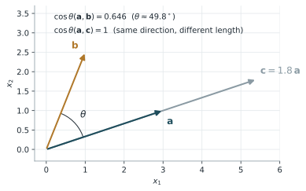

# 餘弦相似性

!!! abstract "摘要"
    餘弦相似性（cosine similarity）以兩個向量夾角的餘弦值衡量它們方向的一致程度，值域為 \(-1\) 至 \(1\)；當向量的分量皆非負時，值域為 \(0\) 至 \(1\)。它只比較方向而忽略長度，因此不受整體縮放影響，適合用來比較「分布形狀」而非「大小」。餘弦相似性廣泛用於資訊檢索、文字與語意向量比對，也常用於工程訊號的特徵向量比較，例如以 WPD 能量分布追蹤設備狀態的變化。本講義說明其定義、幾何意義、與歐氏距離及相關係數的關係，以及使用限制。

    **前置講義**：無（需具備向量內積的基本概念）

## 1. 背景與動機

比較兩個特徵向量時，最直覺的方式是計算歐氏距離。然而歐氏距離同時受方向與長度影響：若兩筆訊號的能量分布形狀完全相同，只是其中一筆的振幅較大，歐氏距離仍然很大。

在許多問題中，我們真正關心的是「比例」或「形狀」。例如以 [WPD](../signal-processing/wpd.md) 計算的頻帶能量分布，重點是能量集中在哪些頻帶；在文件檢索中，重點是各詞彙出現的相對比例，而非文件長度。此時以夾角衡量相似程度更合適，這就是餘弦相似性。

## 2. 數學定義與推導

### 2.1 定義

對兩個 \(d\) 維非零向量 \(\mathbf{a}, \mathbf{b}\)，由內積的幾何定義

$$
\mathbf{a}\cdot\mathbf{b} = \lVert\mathbf{a}\rVert\,\lVert\mathbf{b}\rVert\cos\theta
\tag{1}
$$

可得餘弦相似性

$$
S_C(\mathbf{a},\mathbf{b}) = \cos\theta
= \frac{\mathbf{a}\cdot\mathbf{b}}{\lVert\mathbf{a}\rVert\,\lVert\mathbf{b}\rVert}
= \frac{\sum_{i=1}^{d} a_i b_i}{\sqrt{\sum_{i=1}^{d} a_i^2}\,\sqrt{\sum_{i=1}^{d} b_i^2}}
\tag{2}
$$

\(S_C = 1\) 表示方向相同，\(S_C = 0\) 表示正交，\(S_C = -1\) 表示方向相反。

### 2.2 縮放不變性

對任意正數 \(\alpha\)：

$$
S_C(\alpha\mathbf{a},\mathbf{b}) = S_C(\mathbf{a},\mathbf{b}), \qquad \alpha > 0
\tag{3}
$$

這是餘弦相似性與歐氏距離最大的差異。但要注意，它對平移並不具不變性：\(S_C(\mathbf{a}+\mathbf{c},\mathbf{b}+\mathbf{c})\) 一般不等於 \(S_C(\mathbf{a},\mathbf{b})\)。

### 2.3 與歐氏距離的關係

若先將向量正規化為單位向量 \(\hat{\mathbf{a}} = \mathbf{a}/\lVert\mathbf{a}\rVert\)、\(\hat{\mathbf{b}} = \mathbf{b}/\lVert\mathbf{b}\rVert\)，則

$$
\lVert\hat{\mathbf{a}} - \hat{\mathbf{b}}\rVert^2 = 2\big(1 - S_C(\mathbf{a},\mathbf{b})\big)
\tag{4}
$$

因此在單位向量上，依餘弦相似性排序與依歐氏距離排序的結果相同。

### 2.4 與皮爾森相關係數的關係

將兩向量各自減去平均值後再計算餘弦相似性，即得皮爾森相關係數：

$$
r(\mathbf{a},\mathbf{b}) = S_C(\mathbf{a}-\bar{a}\mathbf{1},\ \mathbf{b}-\bar{b}\mathbf{1})
\tag{5}
$$

其中 \(\mathbf{1}\) 為全為 1 的向量。相關係數因此同時具有縮放與平移不變性。

### 2.5 餘弦距離

實務上常以 \(d_C = 1 - S_C\) 作為「餘弦距離」。須注意 \(d_C\) 不滿足三角不等式，嚴格來說不是度量（metric）；若需要真正的度量，可改用角距離 \(\theta/\pi\)。

## 3. 圖解與範例

圖 1 以二維向量說明餘弦相似性只與夾角有關。\(\mathbf{c} = 1.8\,\mathbf{a}\) 與 \(\mathbf{a}\) 的長度不同，但方向相同，因此餘弦相似性為 1。

<figure markdown="span">
  { width="480" }
  <figcaption>圖 1　向量 a、b 的夾角約 49.8°，餘弦相似性約 0.646；向量 c 為 a 的 1.8 倍，與 a 的餘弦相似性為 1。</figcaption>
</figure>

**計算範例。** 設參考狀態的三頻帶相對能量為 \(\mathbf{e}_{\text{ref}} = [0.6,\ 0.3,\ 0.1]\)，某次量測為 \(\mathbf{e} = [0.3,\ 0.4,\ 0.3]\)，則

$$
\begin{aligned}
\mathbf{e}_{\text{ref}}\cdot\mathbf{e} &= 0.6(0.3) + 0.3(0.4) + 0.1(0.3) = 0.33 \\
\lVert\mathbf{e}_{\text{ref}}\rVert &= \sqrt{0.46} \approx 0.678, \qquad \lVert\mathbf{e}\rVert = \sqrt{0.34} \approx 0.583 \\
S_C &\approx \frac{0.33}{0.678 \times 0.583} \approx 0.834
\end{aligned}
\tag{6}
$$

能量分布由低頻集中轉為較平均，餘弦相似性從 1 下降至約 0.834。

## 4. Python 實作

```python
import numpy as np


def cosine_similarity(a, b):
    """兩向量的餘弦相似性，見式 (2)。"""
    a = np.asarray(a, dtype=float)
    b = np.asarray(b, dtype=float)
    na, nb = np.linalg.norm(a), np.linalg.norm(b)
    if na == 0 or nb == 0:
        raise ValueError("零向量沒有方向，餘弦相似性無定義")
    return float(a @ b / (na * nb))


e_ref = [0.6, 0.3, 0.1]
e = [0.3, 0.4, 0.3]
print(f"S_C = {cosine_similarity(e_ref, e):.3f}")      # 0.834

# 多筆量測對同一參考向量：每一列為一筆特徵向量
E = np.array([[0.6, 0.3, 0.1],
              [0.5, 0.3, 0.2],
              [0.3, 0.4, 0.3]])
s = (E @ np.asarray(e_ref)) / (np.linalg.norm(E, axis=1) * np.linalg.norm(e_ref))
print(np.round(s, 3))
```

若已安裝 scikit-learn，也可使用 `sklearn.metrics.pairwise.cosine_similarity` 一次計算整個矩陣的兩兩相似度。

## 5. 應用實例

**設備與加工狀態追蹤。** 以新砂輪或正常設備的特徵向量作為參考，對之後每一筆量測計算餘弦相似性，可得到一條隨時間變化的相似度曲線；相似度下降代表特徵分布逐漸偏離參考狀態。搭配 [WPD](../signal-processing/wpd.md) 的頻帶相對能量時，這條曲線反映的是能量在各頻帶之間的重新分配。以 WPD 講義圖 2 的兩組能量向量為例，餘弦相似性約為 0.84。

**資訊檢索與語意搜尋。** 文件以詞頻或 TF-IDF 向量表示時，餘弦相似性是衡量文件相關程度的經典方法；現今的語意向量（embedding）檢索也普遍以它比較查詢與文件。

## 6. 限制與注意事項

- **忽略大小資訊。** 縮放不變性是優點也是缺點。若總能量或整體振幅本身就有意義，應另外搭配大小相關的特徵。
- **非負特徵的值域壓縮。** 當所有分量皆非負（例如相對能量），相似度通常集中在接近 1 的區間，差異看起來很小。判讀時應觀察相對變化，或與基準變異範圍比較。
- **各維度尺度不一。** 若特徵向量由不同單位的量組成，數值大的維度會主導結果。應先標準化，但標準化後分量可能為負，值域與解讀方式也隨之改變。
- **零向量無定義。** 程式中需檢查並處理向量長度為 0 的情況。
- **參考向量的選擇。** 追蹤狀態變化時，結果完全取決於參考向量。參考狀態應明確定義，並可取多筆量測的平均以降低隨機變動。

## 7. 相關講義

- [小波封包分解（WPD）](../signal-processing/wpd.md)：產生頻帶能量特徵向量。

## 參考文獻

<div class="references" markdown>

1. G. Salton and M. J. McGill, *Introduction to Modern Information Retrieval*. New York, NY, USA: McGraw-Hill, 1983.
2. C. D. Manning, P. Raghavan, and H. Schütze, *Introduction to Information Retrieval*. Cambridge, U.K.: Cambridge University Press, 2008.

</div>
